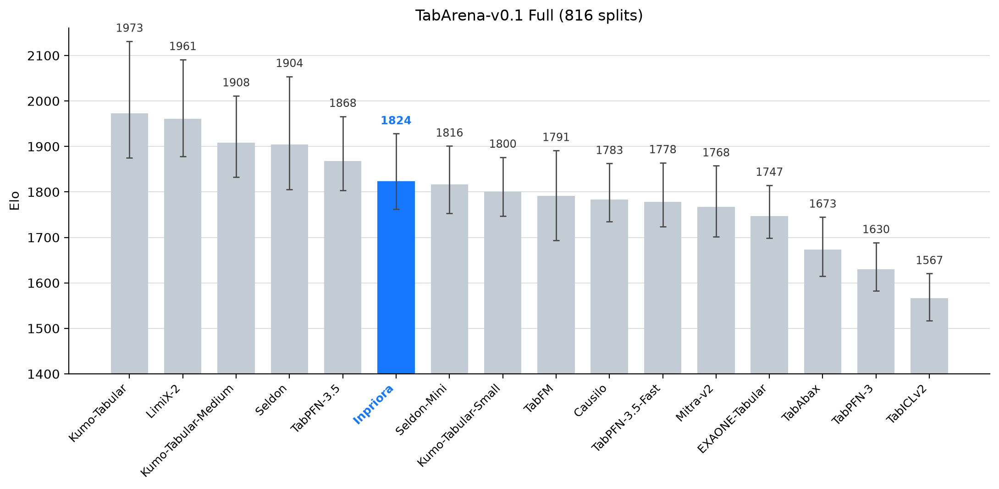

<p align="center">
  
</p>

Inpriora is a pretrained tabular foundation model developed by Ant Group for
classification and regression, trained entirely on synthetic data. The model performs in-context learning: `fit`
prepares the training context, and `predict` / `predict_proba` run forward
passes without gradient updates.
Inpriora encodes cells with adaptive Fourier features and ranks within each
context column, capturing both numerical patterns and relative order.
Its dual-branch ICL processes context and query rows with separate attention
projections, allowing each to retain information suited to its role.

## Installation

```bash
pip install "git+https://github.com/ai-for-data/inpriora.git"
```

Fused RMSNorm and SwiGLU kernels are used automatically when Triton is
available on CUDA half-precision tensors:

```bash
pip install "inpriora[triton] @ git+https://github.com/ai-for-data/inpriora.git"
```

## TabArena performance

Results from a self-run, non-official evaluation on TabArena-v0.1
(51 datasets, 816 splits) on 2026-11-12/13. Ranks are among model submissions.



| Subset | Elo | Rank |
|---|---:|---:|
| Full | 1823.6 | 6/109 |
| Classification | 1786.4 | 7/107 |
| Regression | 2208.6 | 4/105 |

## Quick start

```python
from sklearn.datasets import load_breast_cancer
from sklearn.model_selection import train_test_split

from inpriora import InprioraClassifier

X, y = load_breast_cancer(return_X_y=True)
X_train, X_test, y_train, y_test = train_test_split(X, y, random_state=0)

classifier = InprioraClassifier()
classifier.fit(X_train, y_train)

probabilities = classifier.predict_proba(X_test)
predictions = classifier.predict(X_test)
```

```python
from sklearn.datasets import load_diabetes
from sklearn.model_selection import train_test_split

from inpriora import InprioraRegressor

X, y = load_diabetes(return_X_y=True)
X_train, X_test, y_train, y_test = train_test_split(X, y, random_state=0)

regressor = InprioraRegressor()
regressor.fit(X_train, y_train)
predictions = regressor.predict(X_test)
```

More complete examples are in [`examples/`](examples).

## Model weights

The classifier and regressor checkpoints are hosted on
[Hugging Face](https://huggingface.co/ai-for-data/inpriora). By default, the
estimators download the appropriate checkpoint on first use and reuse the local
Hugging Face cache afterward. Set `revision` to select a specific repository
revision, or `model_path` to load a local checkpoint directory containing
`config.json` and `model.safetensors`. Set `offline=True` to use only locally
available files.

## Caching

`fit` builds a Context cache when `cache=True` (the default). Later `predict`
calls reuse it. Use `cache="repr"` for a smaller cache that re-runs the
in-context transformer at prediction time, or `cache=False` to rebuild the
cache on every call.

Loaded weights are reused across estimator instances on the same device.
Call `inpriora.clear_model_cache()` to release them explicitly.

## Devices and precision

CUDA is used when available, otherwise CPU. Mixed-precision inference (fp16)
is enabled by default on CUDA and can be disabled with `amp=False`.

## Options

Both estimators accept `n_estimators` (the number of ensemble members), `cache`,
`random_seed`, `temperature`, `device` and `amp`. The regressor additionally
accepts `target_transforms`, and its `predict` accepts `output_type` and
`alphas` for distribution summaries.

## Citation

If you use Inpriora in your work, please cite the repository:

```bibtex
@misc{inpriora2026,
  title        = {Inpriora: A Pretrained Tabular Foundation Model for Classification and Regression},
  author       = {Liu, Yunpeng and Wu, Binqing and Liu, Wenkang and Qiu, Wanghui and
                  Cheng, Zijian and Zhang, Jingyuan and Zheng, Tianyi and Fu, Xing and
                  Fu, Xinyi and Cheng, Yu and Wang, Weiqiang and Wang, Ningtao},
  year         = {2026},
  howpublished = {\url{https://github.com/ai-for-data/inpriora}}
}
```

## License

Apache License 2.0. See [LICENSE](LICENSE).

Portions of the model and preprocessing are based on TabICL (BSD 3-Clause,
Copyright (c) 2025 Soda team @ Inria), and the regression bucket distribution
is adapted from TabPFN (Apache License 2.0, Copyright (c) 2026 Prior Labs
GmbH). See [NOTICE](NOTICE) and [THIRD_PARTY_NOTICES.md](THIRD_PARTY_NOTICES.md).
